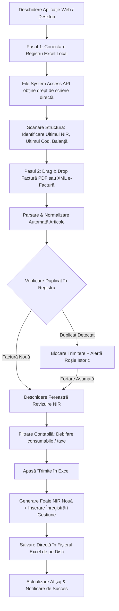

# 📦 Gestiune e-Factură & Generare Automată NIR

> **Aplicație inteligentă pentru automatizarea recepției mărfurilor, generarea automată a Notelor de Intrare-Recepție (NIR) și actualizarea în timp real a registrului de Gestiune Excel.**  
> Dezvoltat pentru: **S.C. BOCAS PROJECT SRL**

---

## 📑 Cuprins
1. [Prezentare Generală & Obiectiv](#-prezentare-generală--obiectiv)
2. [Securitate Strictă & Politica Zero-Leak](#-securitate-strictă--politica-zero-leak)
3. [Funcționalități Cheie](#-funcționalități-cheie)
4. [Arhitectura Tehnică & Structura Proiectului](#-arhitectura-tehnică--structura-proiectului)
5. [Ghid de Instalare & Rulare](#-ghid-de-instalare--rulare)
6. [Fluxul de Lucru al Utilizatorului](#-fluxul-de-lucru-al-utilizatorului)
7. [Sistemul de Design & Moduri Vizuale](#-sistemul-de-design--moduri-vizuale)
8. [Modulul DevOps & System Health](#-modulul-devops--system-health)
9. [Jurnal de Iterativitate & Istoric Versiuni (Changelog)](#-jurnal-de-iterativitate--istoric-versiuni-changelog)
10. [Regulă de Mentenanță a Documentației](#-regulă-de-mentenanță-a-documentației)

---

## 🎯 Prezentare Generală & Obiectiv

Procesul manual tradițional de introducere a facturilor în contabilitatea primară presupunea:
- Transcrierea manuală a fiecărui articol din factură într-o filă nouă de NIR (`Nir 32`, `Nir 33` etc.).
- Introducerea fiecărui produs în foaia centrală `Gestiune`, căutând ultimul cod secvențial (`COD`, ex: `17438`) și codul de intrare (`AALLNN`).
- Alocarea a 15–30 de minute per factură, cu risc ridicat de erori de tastare, pierderi de zecimale și decalaje de rotunjire.

**Soluția:**  
Aplicația permite tragerea cu Drag & Drop a facturii (PDF sau XML e-Factură) direct peste fișierul Excel conectat de pe calculatorul utilizatorului. În **sub 3 secunde**, datele sunt validate, corectate matematic, filtrate de consumabile și scrise direct în registrul Excel nativ, păstrând toate formulele, stilurile și formatările originale.

---

## 🔒 Securitate Strictă & Politica Zero-Leak

Conform directivei obligatorii din [`AGENTS.md`](./AGENTS.md), aplicația respectă cele mai înalte standarde de confidențialitate financiară:

- **100% Client-Side & Local:** Nicio dată extrasă din facturi (CUI, denumiri, prețuri, cantități, conturi bancare) nu părăsește memoria RAM a dispozitivului clientului.
- **Fără Baze de Date Externe sau Cloud Storage:** Fișierele sunt citite și salvate direct pe hard disk prin **File System Access API**.
- **Zero Servicii Terțe de Tracking:** Sentry și orice alt sistem terț de telemetrie externă au fost complet eliminate.
- **Resurse & Dependințe Locale:** Worker-ul PDF (`pdf.worker.min.js`), iconițele și bibliotecile sunt livrate local (`public/` sau bundle intern), fără dependențe externe de tip CDN.
- **Content Security Policy (CSP) Activ:** Politică strictă definită în [`index.html`](./index.html) cu restricție `connect-src 'self'`.
- **Protecție Anti-Formula Injection:** Denumirile produselor externe sunt sanitizate la scriere pentru a împiedica injectarea de formule malițioase (`=`, `+`, `-`, `@`) la deschiderea în MS Excel.
- **Protecție XXE:** Parsarea XML cu `fast-xml-parser` este securizată împotriva atacurilor de tip XML External Entities.

---

## 🚀 Funcționalități Cheie

### 1. Parsare Polimorfică de Facturi
- **XML e-Factură (UBL standard ANAF):** Extrage detaliat datele fiscale din `cac:InvoiceLine`, cantități, prețuri unitare, unități de măsură internaționale și datele furnizorului/cumpărătorului.
- **PDF Facturi (SmartBill, SPV, Linde Gaz etc.):** Algoritm avansat bazat pe coordonate Y (linii) pentru identificarea și asamblarea tabelelor cu poziții de produse.

### 2. Fidelitate Contabilă & Rezolvarea Rotunjirilor (ex: Linde Gaz)
- Calculează `effectiveUnitPrice` cu precizie de 4 zecimale.
- Previne discrepanțele specifice facturilor de gaze tehnice sau produse industriale unde prețul este afișat rotunjit la 2 zecimale pe factură, dar calculat intern cu 4 zecimale, garantând că suma totală bate la ban cu documentul fiscal.

### 3. Cartografiere Automată a Unităților de Măsură (U/M)
Traducere automată a codurilor internaționale UBL în abrevieri contabile standard românești:
- `H87`, `PCE`, `C62` → `BUC.`
- `MTQ` (metri cubi) → `MC.` (cu eliminare automată a redundantelor din text)
- `MTK` → `MP.`
- `MTR` → `ML.`
- `KGM` → `KG.`
- `LTR` → `L.`
- `SET` → `SET`, `PR` → `PER`

### 4. Filtrare Contabilă a Consumabilelor
- Operatorul poate bifa/debifa articole specifice (ex: taxe paleți, pungi, pietre de polizor, chirii).
- Articolele debifate sunt incluse în foaia NIR pentru recepție, dar **nu poluează foaia centrală `Gestiune`**.

### 5. Barieră Dublă Anti-Duplicat
- Normalizare canonică a numărului de factură (eliminare prefixe, spații, zerouri nesemnificative).
- Scanare completă a istoricului din registrul Excel (`D11` din fiecare foaie `Nir XX`).
- Blocare vizuală imediată la nivel de interfață (`Factură Duplicat (Blocat)`) cu alertă vizuală.
- Refuz de scriere în `excelEngine.js` dacă forțarea duplicatului nu este asumată explicit de utilizator.

### 6. Păstrare Nativă a Stilurilor Excel (`ExcelJS`)
- Păstrează 100% din stiluri, fonturi, borduri, culori și formule native ale registrului clientului.
- Formatare automată: rândurile de antet (1 și 2) sunt mărite pentru lizibilitate optimă, iar toate celulele cu valori numerice sunt aliniate automat la dreapta.
- Suportă atât foi denumite `Gestiune`, cât și variații scurte (`G`) sau foi numerice lunare (`1`..`12`).

### 7. Explorator Excel Live Integrat
- Permite vizualizarea oricărei foi din registru (`Gestiune`, NIR-uri individuale) direct în aplicație, fără a fi nevoie de deschiderea fișierului în Microsoft Excel.
- Oferă buton direct de descărcare a fișierului actualizat.

---

## 🏗️ Arhitectura Tehnică & Structura Proiectului

### Tehnologii Utilizate
- **Frontend:** React 18, Vite 6
- **Stiluri & Design:** CSS Modules + Neumorphism 2.0 (Design Neo-Skeuomorphic cu teme Light/Dark)
- **Prelucrare Excel:** `exceljs`
- **Parsare Documente:** `pdfjs-dist` (local worker), `fast-xml-parser`
- **Desktop Runtime:** Electron 44 & Electron Builder (pentru executabile Windows și macOS)
- **Iconografie:** Lucide React

### Structura Directorului
```text
Proiect_Adrian_Besleaga/
├── AGENTS.md                  # Politica strictă de securitate și Zero-Leak
├── SPECIFICATII_PROIECT.md    # Caiet de sarcini, audit de securitate și arhitectură
├── README.md                  # Documentația principală a proiectului și jurnalul de iterații
├── index.html                 # Punct de intrare HTML cu configurare strictă CSP
├── package.json               # Dependințe și scripturi npm
├── vite.config.js             # Configurare Vite
├── electron/
│   └── main.cjs               # Procesul principal Electron pentru modul desktop nativ
├── standalone-monitor/
│   ├── main.swift             # Cod sursă monitor nativ macOS (DevOps)
│   └── Info.plist
├── public/                    # Resurse statice (manifest PWA, icoane, worker PDF)
└── src/
    ├── App.jsx                # Componenta rădăcină și coordonarea stării
    ├── App.module.css
    ├── main.jsx               # Inițializare React DOM
    ├── index.css              # Variabile globale CSS și stiluri de temă (Light/Dark)
    ├── components/
    │   ├── Header.jsx              # Bară navigare, temă, status registru
    │   ├── ExcelConnector.jsx      # Conectare registru local, selecție fișier
    │   ├── DropZone.jsx            # Zonă Drag & Drop pentru facturi PDF/XML
    │   ├── NirReviewModal.jsx      # Fereastră de revizuire și filtrare articole NIR
    │   ├── NirViewModal.jsx        # Vizualizare rapidă foaie NIR salvată
    │   ├── LiveExcelExplorer.jsx   # Explorator tabele Excel direct în browser
    │   ├── SuccessBanner.jsx       # Alertă feedback succes
    │   ├── InstructionsModal.jsx   # Ghid pas cu pas pentru utilizator
    │   └── DevOpsMonitor.jsx       # Panou local de diagnostic și sănătate sistem
    └── services/
        ├── fileSystem.js           # File System Access API (citire/scriere locală)
        ├── excelEngine.js          # Motor manipulare workbook, clonare, scriere NIR
        ├── pdfParser.js            # Extragere date și tabele din facturi PDF
        ├── xmlParser.js            # Extragere date din XML e-Factura UBL
        ├── localHealthStore.js     # Jurnal local de incidente și audit
        └── remoteTelemetry.js      # Stub securizat (Zero-Leak activat)
```

---

## 💻 Ghid de Instalare & Rulare

### Cerințe Preliminare
- **Node.js** >= 18.0.0
- **npm** >= 9.0.0

### Instalare Dependințe
```bash
npm install
```

### Rulare în Mod Dezvoltare (Web / PWA)
```bash
npm run dev
```
Aplicația va fi accesibilă la adresa `http://localhost:5173`.

### Rulare ca Aplicație Desktop (Electron)
```bash
npm run desktop
```

### Construire Pachete Producție
- **Build Web (dist):**
  ```bash
  npm run build
  ```
- **Kit Instalare Windows (NSIS & Portable x64):**
  ```bash
  npm run dist:win
  ```
- **Kit Instalare macOS (DMG & ZIP):**
  ```bash
  npm run dist:mac
  ```

---

## 🔄 Fluxul de Lucru al Utilizatorului



---

## 🎨 Sistemul de Design & Moduri Vizuale

Aplicația folosește un sistem de design **Neumorphism 2.0 (Neo-Skeuomorphic)**:
- Butoane tactile 3D cu umbre duble, micro-interacțiuni fluide și colțuri rotunjite generoase.
- **Mod Luminos (Light ☀️):** Nuanțe pastel de ardezie deschisă (`#d3dbe6`), carduri curate (`#eef2f7`), umbre tactile discrete.
- **Mod Întunecat (Dark 🌙):** Nuanțe de obsidian slate (`#0b1120`), carduri de profunzime (`#172033`), accente cyan neon (`#38bdf8`).
- Comutarea temei se realizează printr-un singur click din Header, iar opțiunea este memorată automat în `localStorage` (`bocas_theme`).

---

## 🩺 Modulul DevOps & System Health

Pentru diagnosticarea rapidă a incidentelor tehnice fără a expune datele clientului:
- Incidentele și excepțiile sunt înregistrate 100% local în [`localHealthStore.js`](./src/services/localHealthStore.js).
- **Acces Administrator:** Panoul DevOps este ascuns în interfața de zi cu zi a clientului și poate fi deschis prin scurtătura tastaturii:
  - `Ctrl + Shift + D` (Windows/Linux)
  - `Cmd + Shift + D` (macOS)
- Permite inspectarea istoricului de erori, testarea integrității fișierelor și resetarea jurnalului local.

---

## 📜 Jurnal de Iterativitate & Istoric Versiuni (Changelog)

Fiecare nouă iterație, adăugare de funcționalitate sau corecție va fi documentată în acest tabel:

| Versiune / Commit | Data | Modul / Fișiere Afectate | Descrierea Modificărilor & Rezultate |
| :--- | :---: | :--- | :--- |
| **v1.0.0** (`32f76ef`) | Octombrie 2026 | `excelEngine`, `pdfParser`, `xmlParser`, `App` | Lansare arhitectură de bază: generare automată NIR din PDF/XML, actualizare stoc Gestiune, conectare directă Excel. |
| **v1.1.0** (`e7a99f6`) | Octombrie 2026 | `ExcelConnector.jsx`, `App.jsx` | Limitare istoric NIR la maximum 10 înregistrări recente pentru performanță sporită a interfeței. |
| **v1.2.0** (`52d2409`) | Octombrie 2026 | `ExcelConnector.jsx`, `Header.jsx` | Îmbunătățire badge `ULTIMUL NIR` cu hover vizual albastru și buton interactiv pentru deschiderea rapidă a foii `Gestiune`. |
| **v1.3.0** (`151ae6d`) | Octombrie 2026 | `ExcelConnector.jsx`, `LiveExcelExplorer.jsx` | Eliminare buton redundant de descărcare la Pasul 1; centralizare acțiune de download în Explorator Excel. |
| **v1.4.0** (`f8c0fa5`) | Octombrie 2026 | `excelEngine.js`, `public/sw.js` | Extindere compatibilitate pentru foaia `G`, foi lunare numerice `1..12` și optimizare fetch handler în Service Worker. |
| **v1.5.0** (`5c51ccb`, `6f6a124`) | Octombrie 2026 | `AGENTS.md`, `index.html`, `main.jsx`, `public/` | **Standarde Maxime de Securitate:** Eliminare completă Sentry, worker PDF servit 100% local, activare CSP strict anti-scurgere, adoptare directivă `AGENTS.md` Zero-Leak. |
| **v1.6.0** (`8c6535c`, `0fe82a1`) | Octombrie 2026 | `localHealthStore.js`, `DevOpsMonitor.jsx`, `standalone-monitor/` | Adăugare modul intern DevOps & System Health Monitor 100% local; adăugare sursă monitor nativ macOS. |
| **v1.7.0** (`a665090`) | Octombrie 2026 | `App.jsx`, `Header.jsx` | Eliminare buton DevOps din interfața vizibilă a clientului; acces exclusiv prin scurtătură secretă de tastatură (`Ctrl/Cmd + Shift + D`). |
| **v1.8.0** (`704e143`) | Octombrie 2026 | `excelEngine.js`, `public/sw.js` | Rafinare verificare duplicat: rezolvare detecții eronate la facturi distincte; actualizare cache Service Worker la v3. |
| **v1.9.0** (`2675f16`) | Octombrie 2026 | `excelEngine.js`, `App.jsx` | **Optimizare Formatare Excel:** Înălțare automată a rândurilor de antet 1 și 2 și aliniere la dreapta pentru toate celulele cu valori numerice pe foile NIR și Gestiune. |
| **v2.0.0** (`eb59a61`) | 25 Oct 2026 | `README.md` | **Creare Documentație Completă:** Redactare `README.md` exhaustiv, structură ghid, politică de securitate și protocol de actualizare la fiecare iterație. |

---

## 📌 Regulă de Mentenanță a Documentației

> [!IMPORTANT]
> **DIRECTIVĂ OBLIGATORIE PENTRU DEZVOLTATORI ȘI ASISTENȚI AI:**  
> După **FIECARE** iterație, funcționalitate adăugată, refactorizare sau remediere de eroare (bug fix), este **obligatorie actualizarea acestui fișier (`README.md`)**:
> 1. Adăugarea unui nou rând în tabelul [Jurnal de Iterativitate & Istoric Versiuni](#-jurnal-de-iterativitate--istoric-versiuni-changelog) cu versiunea/hash-ul, data, fișierele modificate și sumarul clar al schimbărilor.
> 2. Actualizarea secțiunilor relevante din documentație dacă s-au schimbat comportamente, scurtături, comenzi sau structura de fișiere.
