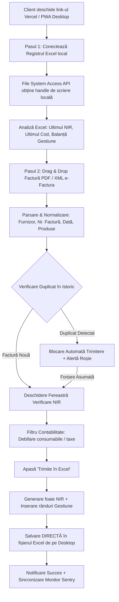

# Caiet de Sarcini, Arhitectură Tehnică & Audit de Securitate
## Proiect: Automatizare Generare NIR & Actualizare Gestiune din e-Factura

> [!IMPORTANT]
> **Esența Proiectului:**  
> Clientul deschide aplicația web (sau aplicația instalată pe Desktop via PWA) → Conectează registrul său Excel de gestiune → Trage factura (PDF sau XML e-Factura) cu Drag & Drop → Sistemul validează, filtrează și trimite datele direct în fișierul Excel de pe calculatorul său (creează fila `Nir XX` + actualizează foaia `Gestiune`).  
> **Securitate 100%:** Datele financiare nu părăsesc niciodată calculatorul clientului (procesare locală client-side).

---

### 1. Contextul Proiectului și Problema Rezolvată

* **Beneficiar:** S.C. BOCAS PROJECT SRL  
* **Fluxul manual anterior:**
  1. Operatorul descărca facturile din Spațiul Privat Virtual (SPV / e-Factura) sau din softul de facturare (SmartBill etc.).
  2. Transcria manual fiecare factură în fișierul Excel de gestiune:
     - Crea o filă nouă de NIR (`Nir 32`, `Nir 33` etc.), completând datele furnizorului, documentul și articolele cu preț, cantitate și valoare.
     - Introduce fiecare produs în foaia centrală `Gestiune` la coloanele de intrări, căutând manual ultimul cod secvențial (`COD`, ex: `17438`) și codul de NIR (`AALLNN`, ex: `260834`).
  3. Procesul dura între 15 și 30 de minute per factură și era expus la erori de tastare, pierderi de zecimale și riscul dublării accidentale a stocurilor.

* **Obiectiv atins:**  
  O aplicație modernă, distribuită prin cloud (Vercel) cu instalare pe Desktop, care reduce timpul de introducere la **sub 3 secunde per factură**, garantând fidelitatea 100% a calculelor și eliminarea completă a erorilor umane.

---

### 2. Arhitectura Tehnică a Sistemului

#### Componentele Arhitecturale:
1. **Frontend & UI (React 18 + Vite):**
   - Interfață neo-tactilă (Neumorphic 2.0) cu contrast vizual optim, culori curate, butoane stilizate și modale intuitive.
   - PWA (Progressive Web App) configurat cu Service Worker (`sw.js`) și `manifest.json`, permițând instalarea aplicației direct pe ecranul calculatorului (Desktop Windows / Mac).
2. **Motorul de Parsare a Facturilor (`pdfParser.js` & `xmlParser.js`):**
   - **XML e-Factura (UBL standard ANAF):** Extragere precisă din structura `cac:InvoiceLine`, cantități, prețuri și unități de măsură internaționale.
   - **PDF (SmartBill / SPV / Linde Gaz etc.):** Algoritm avansat de grupare a textului pe coordonate Y (linii), extragere coloane numerice și recunoaștere automată a tabelelor de produse.
3. **Motorul de Gestiune Excel (`excelEngine.js`):**
   - Bazat pe `exceljs`, singura bibliotecă capabilă să cloneze structuri complexe de foi de calcul **păstrând 100% stilurile celulelor, fonturile, bordurile și formulele native Excel**.
4. **Legătura cu Fișierele Locale (`fileSystem.js`):**
   - Folosește **File System Access API** (`showOpenFilePicker` și `createWritable`), permițând citirea și **salvarea înlocuită direct pe hard disk-ul utilizatorului**, fără a descărca duplicate în folderul *Downloads*.

---

### 3. Fidelitatea Datelor & Calculul Contabil

#### A. Rezolvarea Discrepanțelor de Rotunjire (ex. Linde Gaz / Gaze Tehnice)
* În sistemele de facturare industriale (Linde Gaz), prețul unitar din baza de date are frecvent 4 zecimale (ex: `21,9849 lei/mc`), dar pe factură se tipărește rotunjit la 2 zecimale (`21,98 lei`).
* Dacă se calculează naiv $19{,}20 \times 21{,}98$, rezultă $422{,}02\text{ lei}$ (o pierdere de 9 bani față de valoarea facturii de $422{,}11\text{ lei}$).
* **Soluția implementată:** Aplicația calculează `effectiveUnitPrice` cu precizie de 4 zecimale și transmite ca rezultat garantat valoarea oficială din factură ($422{,}11\text{ lei}$), astfel încât la deschiderea în Microsoft Excel, toate sumele și formulele bat la ban cu documentul fiscal.

#### B. Cartografierea Unităților de Măsură (U/M)
Sistemul recunoaște și traduce automat codurile UBL e-Factură în unități contabile românești:
* `H87`, `PCE`, `C62` → `BUC.`
* `MTQ` (metru cub volum gaze/lichide) → `MC.` (curățat automat din denumirea produsului)
* `MTK` → `MP.`
* `MTR` → `ML.`
* `KGM` → `KG.`
* `LTR` → `L.`
* `SET` → `SET`, `PR` → `PER`

#### C. Filtrarea Contabilă a Consumabilelor
Înainte de trimiterea în registrul de stocuri, operatorul poate debifa cu un click articolele care sunt consumabile sau taxe (ex: *pungi, pietre de polizor, taxe de cogenerare, chirie ambalaje*). Acestea rămân vizibile în istoricul de recepție, dar **nu poluează fișa de stoc din `Gestiune`**.

---

### 4. Siguranță & Protecție Anti-Duplicat

Sistemul include o barieră dublă împotriva introducerii duble a aceleiași facturi:
1. **Normalizarea Numărului de Factură:** Eliminare spații, caractere speciale, prefixe și zerouri nesemnificative (ex: `4401312819`, `0089180` devin chei canonice comparabile).
2. **Scanarea Istoricului:** Compară numărul facturii noi cu toate facturile din tab-urile existente (`D11` din fiecare foaie `Nir XX`) și din lotul curent încărcat.
3. **Blocare Automată la Nivel de Interfață:** Dacă factura există deja, butonul de trimitere este blocat (`Factură Duplicat (Blocat)`), iar sistemul afișează un avertisment cu foaia exactă în care a fost deja introdusă.
4. **Barieră la Nivel de Motor (Core Engine):** `excelEngine.js` refuză execuția dacă duplicatul nu a fost confirmat explicit prin bifarea căsuței de asumare a forțării.

---

### 5. Audit de Securitate & Confidențialitate (GDPR)

Un audit complet al securității a fost efectuat asupra bazei de cod, confirmând următoarele standarde:

| Criteriu Securitate | Măsură Implementată | Nivel Risc |
| :--- | :--- | :---: |
| **Confidențialitate Date Financiare** | **Zero-Server Storage:** Toate fișierele (facturi PDF/XML, registru Excel) sunt procesate **exclusiv în memoria RAM a browserului clientului**. Niciun document nu este trimis, salvat sau stocat pe servere externe. Conformitate 100% GDPR. | **ZERO** |
| **Prevenire Excel Formula Injection** | Textele denumirilor de produse preluate din facturi externe sunt verificate înainte de scriere în celulele Excel. Dacă un produs începe cu caractere susceptibile de execuție de formule (`=`, `+`, `-`, `@`), acesta este prefixat ca text sigur (`'`), prevenind atacurile de tip CSV/Formula Injection la deschiderea în MS Excel. | **SECURIZAT** |
| **Protecție XXE (XML External Entities)** | Biblioteca `fast-xml-parser` este configurată în mod securizat, fără rezolvare de entități externe sau apeluri de rețea dtd, eliminând complet riscurile de atac XXE prin fișiere XML malițioase. | **SECURIZAT** |
| **Protecție Sentry Data Masking** | În `main.jsx`, integrarea Sentry Session Replay are configurat `maskAllText: true` și `blockAllMedia: true`. Datele financiare, valorile facturilor și CUI-urile nu sunt înregistrate în rapoartele video de telemetrie. | **SECURIZAT** |
| **Securitate Comunicații Web** | Deservire prin **HTTPS / TLS 1.3** pe Vercel, cu antete de izolare `Cross-Origin-Opener-Policy: same-origin-allow-popups`. | **SECURIZAT** |

---

### 6. Monitorizare în Timp Real (Sentry Error Tracking)

Aplicația este conectată la **Sentry.io** pentru a oferi monitorizare proactivă fără a necesita intervenția utilizatorului:
* **DSN dedicat proiectului:** `https://9302e9ea7bc...@o4512083459440640.ingest.de.sentry.io/4512083472613456`
* **Notificări pe telefon:** Imediat ce o factură cu format necunoscut generează o excepție, dezvoltatorul primește notificare push pe aplicația mobilă Sentry și pe email.
* **Stack Trace detaliat:** Raportul conține linia exactă de cod, versiunea browserului și pașii parcurși de client înainte de apariția problemei, permițând rezolvarea rapidă fără a fi nevoie de asistență remote (TeamViewer).

---

### 7. Ghid de Distribuție, CI/CD & Mentenanță

* **Repository GitHub:** `https://github.com/scaevola1981/bocas_nir_aplication`
* **Găzduire Producție:** [Vercel](https://vercel.com) (conectat automat la branch-ul `main`).
* **Flux de Actualizare (Zero Downtime):**
  1. Orice îmbunătățire adusă codului este urcată cu `git push origin main`.
  2. Vercel compilează și publică noua versiune în aproximativ 25 de secunde.
  3. Clientul deschide aplicația pe Desktop sau dă refresh în browser și primește automat versiunea actualizată, fără reinstalări manuale.

---

### 8. Sistemul de Design: Neumorphism 2.0 (Teme Light & Dark)

* **Design Neo-Skeuomorphic:**
  * Butoane tactile 3D cu umbre duale (convex, concav, pressed).
  * Borduri fine cu accente cyan/albastru (`#38bdf8`) cu reacție vizuală completă la hover și active click.
  * Header plutitor cu colțuri generoase rotunjite (`border-radius: 28px`).
* **Comutare Instantă a Temei (Light ☀️ / Dark 🌙):**
  * Buton dedicat în Header lângă iconița de instrucțiuni `?`.
  * **Mod Luminos (Light):** Fundal slate deschis `#d3dbe6` cu carduri `#eef2f7` și umbre reliefate albe/gri.
  * **Mod Întunecat (Dark):** Obsidian slate `#0b1120` cu carduri `#172033`, umbre de profunzime `#060a13` și bevel luminous subtil `rgba(35, 48, 72, 0.45)`.
  * **Persistență:** Preferința utilizatorului este memorată automat în `localStorage` (`bocas_theme`).

