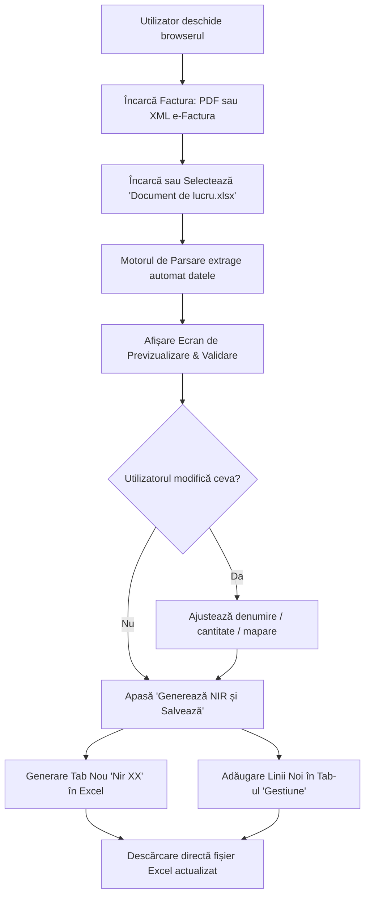

# Caiet de Sarcini & Arhitectură Tehnică
## Proiect: Automatizare Generare NIR & Actualizare Gestiune din e-Factura

> [!IMPORTANT]
> **Esența Proiectului (Pe Scurt):**  
> Clientul face **Drag & Drop** cu factura în program $\rightarrow$ programul o citește automat $\rightarrow$ o transformă și o trimite direct în **Excel**, sub forma exactă existentă (creează tab-ul `Nir XX` corespunzător + adaugă intrările în foaia `Gestiune`). Zero instalare pe calculatorul clientului, 100% online.

---

### 1. Contextul Proiectului și Problema Rezolvată

**Client:** S.C. BOCAS PROJECT SRL  
**Fluxul manual actual:**
1. Clientul descarcă facturile de la furnizori (fie direct din Spațiul Privat Virtual - SPV / e-Factura, fie prin SmartBill / alte softuri de facturare, sub formă de fișiere PDF sau XML).
2. În mod manual, operatorul citește fiecare factură și transcrie datele în fișierul Excel de gestiune (`Document de lucru.xlsx`):
   - Creează o filă nouă de **Nota de Intrare Recepție (NIR)** (ex: `Nir 32`, `Nir 33`, `Nir 34` etc.), completând datele furnizorului, numărul facturii, data și fiecare linie de produs cu preț, cantitate și valoare.
   - Desface și introduce fiecare produs în foaia centrală **`Gestiune`** la coloanele de **INTRĂRI**, alocând manual un **COD intern** (ex: `17434`, `17435`, `17436`, `17437`) și un identificator de **NIR** (ex: `260832`, `260833`, `260834`).
3. Acest proces manual este consumator de timp, repetitiv și expus la greșeli de tastare la prețuri, cantități sau formule.

**Obiectivul:**  
Realizarea unei soluții software accesibile de la distanță, care să preia factura electronică (PDF sau XML e-Factura), să extragă automat datele și să actualizeze direct fișierul Excel, respectând 100% structura, formulele și formatarea existentă.

---

### 2. Analiza Datelor și Documentelor Existente

În urma inspectării fișierelor de lucru (`Document de lucru.xlsx` și a facturilor furnizor: *BEIJER REF ROMANIA SRL*, *SARMIS COMEX S.R.L.*), a fost identificată următoarea structură de date:

#### A. Tab-ul Central `Gestiune` (Balanță Stocuri Lunară)
* **Antet:** Luna și Anul (ex: `AUGUST 2026`).
* **Coloane esențiale:**
  * `Col A`: **DENUMIRE PRODUS**
  * `Col B`: **COD** intern (număr secvențial, de exemplu de la `13025` până la `17437` etc.).
  * `Col C`: **NIR** (format `AALLNN` – ex: `260834` = An 2026, Luna 08, NIR nr. 34).
  * `Col D`: **U/M** (BUC., ML., KG., etc.).
  * `Col E - G`: **STOC LA 01.LL.AAAA** (Cantitate, Preț Unitar, Valoare).
  * `Col H - J`: **INTRĂRI LUNA** (Cantitate, Preț Unitar, Valoare).
  * `Col K - M`: **IEȘIRI LUNA** (Cantitate, Preț Unitar, Valoare).
  * `Col N - P`: **STOC LA SFÂRȘITUL LUNII** (Cantitate, Preț Unitar, Valoare).
* **Comportament observat:** Articolele intrate pe facturi noi sunt adăugate la finalul listei din `Gestiune`, primind următorul cod secvențial (`COD = ultimul_cod + 1`).

#### B. Tab-urile Individuale de NIR (`Nir 32`, `Nir 33`, `Nir 34`...)
* Șablon formal de recepție pentru fiecare factură în parte:
  * **Antet firmă:** Datele cumpărătorului (S.C. BOCAS PROJECT SRL, CUI, sediu, cont IBAN).
  * **Număr NIR:** `NOTE DE INTRARE RECEPȚIE Nr. [XX]`.
  * **Furnizor:** `Se recepționează mărfurile furnizate de [NUME_FURNIZOR]`.
  * **Document sursă:** `Conform facturii [NR_DOC] din [DATA_DOC]`.
  * **Tabel produse (rândul 14 în jos):**
    * `Col A`: nr. crt.
    * `Col B`: Denumire produs
    * `Col C`: U/M
    * `Col D`: Cantitate
    * `Col E`: Preț unitar fără TVA
    * `Col F`: Valoare fără TVA
    * `Col G`: Cod intrare (același cu COD-ul din tabul `Gestiune`)
  * **Subsol:** Rândul de `TOTAL` cu formula sumei pentru valorile fără TVA.

#### C. Facturile Sursă (e-Factura & Documente Fizice)
* **Formatul principal:** Facturi descărcate din e-Factura / SPV / SmartBill în format **PDF** (așa cum sunt cele din mostre).
* **Compatibilitate extinsă:** Aplicația va fi pregătită să accepte și fișiere **XML (standard e-Factura UBL)**, precum și posibilitatea viitoare de procesare prin OCR a facturilor fizice fotografiate/scanate.
* **Fidelitate față de șablon:** Structura generată în Excel va respecta cu strictețe 100% șablonul din fișierul de referință oferit (`Document de lucru.xlsx`).

---

### 3. Scenariul de Utilizare (User Journey)

* **Context operațional:** Clientul se află la distanță față de dezvoltator. Clientul va folosi aplicația web pe **propriul său calculator (PC)**, exact acolo unde se află stocat și fișierul lui Excel de gestiune (`Document de lucru.xlsx`).
* **De ce Web App / PWA:** Se elimină complet necesitatea de a fi prezent la calculatorul clientului pentru instalări, configurații de sistem, actualizări sau depanare. Orice modificare adusă codului de către dezvoltator pe GitHub ajunge automat pe calculatorul clientului la următoarea accesare.
* **Cum se leagă aplicația de Excel-ul de pe PC-ul clientului:** 
  Folosind tehnologia nativă a browserului (**File System Access API** în Chrome / Edge), clientul alege fișierul Excel o singură dată de pe hard disk-ul propriu (ex: de pe Desktop). Din acel moment, la fiecare factură aprobată, aplicația **actualizează și salvează modificările DIRECT în fișierul de pe PC-ul lui**, exact în folderul original, fără descărcări manuale repetitive.

#### Etapele pas cu pas:
1. **Accesare aplicație (PWA):**  
   Clientul deschide aplicația web în browser (pe Vercel). Nu necesită instalare pe stația de lucru.
2. **Încărcare Factură (Pasul 1):**
   * Clientul face **Drag & Drop** cu factura (PDF sau XML e-Factura).
   * Programul o citește și o formatează complet conform regulilor Excel-ului.
3. **Studierea și Verificarea Datelor (Pasul 2 - Ecranul de Control & Filtrare Contabilă):**
   * Aplicația extrage și include inițial **toate produsele** de pe factură în propunerea de NIR.
   * **Filtru esențial pentru Contabilitate:** Înainte de scrierea în Excel, clientul **studiază NIR-ul** și are posibilitatea de a **elimina / debifa produsele care nu aparțin de contul de gestiune de mărfuri/materii prime** (de exemplu consumabile precum *pungi*, *piatră de polizor*, *materiale mărunte* etc., care în contabilitate merg pe alte conturi și nu se trec în acest registru de stocuri).
   * Clientul elimină rapid aceste articole cu un simplu click (buton de ștergere sau debifare pe rând).

4. **Trimiterea în Excel-ul de Contabilitate:**
   * Când NIR-ul este validat de client (rămânând doar produsele de gestiune), se apasă **„Trimite în Excel”**.
   * Se preiau toate produsele validate din NIR și se trec automat în foaia **`Gestiune`** (fișierul de contabilitate), ca rânduri noi la finalul tabelului, incrementând numărul/codul secvențial (`17438...`).
   * Se creează tab-ul nou de NIR (ex: `Nir 35`) și se actualizează fișierul Excel de contabilitate.

---

### 4. Tehnologii Recomandate & Justificare

Pentru a garanta stabilitate, mentenanță la distanță zero pe stația clientului și integritatea datelor din Excel, stiva tehnologică recomandată este:

| Componentă | Tehnologie Aleasă | Justificare |
| :--- | :--- | :--- |
| **Tip Aplicație** | **PWA (Progressive Web App)** | Se deschide direct în browser prin link securizat; clientul o poate „instala” opțional pe desktop cu un singur click din browser, fără asistență tehnică. Zero instalare nativă. |
| **Găzduire & CI/CD** | **Vercel + GitHub** | Fiecare modificare/îmbunătățire trimisă pe GitHub se propagă automat pe Vercel (deploy automat). Mentenanță 100% la distanță. |
| **Stilizare (CSS)** | **CSS Modules (`*.module.css`)** | Fără Tailwind. CSS curat, modularizat pe componente, ușor de citit, înțeles și menținut. Fără clase lungi aglomerate în JSX. |
| **Framework Web** | **Next.js (sau React + Vite)** | Suport complet pentru PWA, viteză maximă și API routes integrate pentru procesare fișiere. |
| **Manipulare Excel** | **`exceljs`** | Singura librărie sigură pentru Node.js capabilă să deschidă `Document de lucru.xlsx`, să cloneze foi de lucru (template NIR) și să adauge intrări în `Gestiune` **fără să altereze stilurile, formatarea celulelor sau formulele vechi**. |
| **Procesare Facturi** | **`fast-xml-parser` + `pdf-parse`** | Suport dublu: atinge precizie de 100% pe XML e-Factura și permite extragerea din PDF-urile descărcate din SmartBill / SPV. |

---

### 5. Beneficii Directe pentru Client și Dezvoltator

* **Timp redus:** Transcrierea unei facturi scade de la 10-15 minute la **3 secunde**.
* **Fără erori umane:** Prețurile, cantitățile și zecimalele sunt preluate identic din factura electronică.
* **Siguranță Anti-Duplicat (Protecție Automată):**
  - **Verificare Număr Factură:** La fiecare încărcare, numărul facturii este normalizat (eliminare caractere speciale, separare serie de număr, eliminare zerouri nesemnificative) și comparat cu toate facturile din tab-urile existente (`D11` din fiecare foaie `Nir XX`) și din fișierele din același lot.
  - **Blocare Automată:** Dacă o factură există deja în Excel (ex: `89180` în `Nir 34`, `15560` în `Nir 32`), sistemul blochează automat butonul de trimitere („Factură Duplicat - Blocat”), afișează un banner roșu de alertă și oprește scrierea.
  - **Barieră Dublă (UI & Engine):** Chiar și dacă s-ar apela funcția de scriere, `processInvoiceIntoExcel` aruncă o excepție de siguranță dacă duplicatul nu a fost asumat explicit prin bifarea căsuței de deblocare forțată.
  - **Prevenire Erori Umane:** Împiedică dublarea stocurilor în gestiune și denaturarea balanței contabile dacă utilizatorul trage din greșeală aceeași factură de două ori.
* **Fără dependență de locație:** Clientul poate folosi aplicația de oriunde, iar dezvoltatorul poate interveni sau adăuga funcții noi de la distanță, fără să fie prezent fizic la biroul clientului.
* **Compatibilitate completă:** Formatul final al fișierului `Document de lucru.xlsx` rămâne 100% neschimbat față de ce folosește clientul în prezent.

---

### 6. Pașii Următori

1. Aprobarea scenariului și a fluxului de către client.
2. Construirea nucleului de procesare (modulul de citire facturi + modulul de scriere Excel).
3. Dezvoltarea interfeței web (ecranul de upload și previzualizare).
4. Testare pe setul de facturi existente și validarea rezultatului final în Excel.
